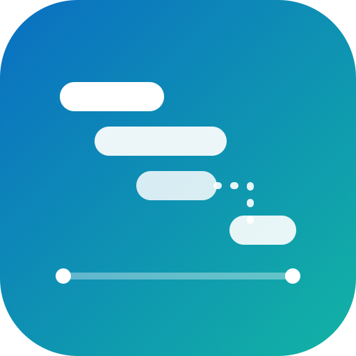

# Workflow Trace Explorer



A New Relic One app (Nerdpack) for exploring **long-running, asynchronous and human-in-the-loop
workflows** as one unit, instead of as a scatter of unrelated traces.

Standard distributed tracing assumes short, synchronous requests. Workflows that retry with backoff,
cross message queues, or wait hours or days for a person to approve break that assumption: the trace
splits, parents go missing, and spans are dropped by platform limits. This app puts the pieces back
together using the data already in New Relic.

## Contents

- [Features](#features)
- [Requirements](#requirements)
- [Installation and local run](#installation-and-local-run)
- [Getting started](#getting-started)
- [Configuration](#configuration)
- [Known limitations](#known-limitations)
- [Development](#development)
- [Deployment](#deployment)
- [License](#license)

## Features

### Summary page

- **Every workflow in the time range.** Columns: workflow ID, app, entry transaction, state,
  started, last activity, duration, **HIL** and **HIL decision**, traces, spans, entities,
  databases, span links and errors. All columns sort. The table draws 200 rows at a time (Show more
  / Show all).
- **Time range** comes from the platform time picker at the top right (relative or absolute). Until
  the platform reports a range it uses the last 30 minutes.
- **Filters that search the whole range, not just the rows shown:**
  - **App** multi-select next to the account picker.
  - **Search** (matches workflow IDs or app names containing the text). If nothing matches, the app
    checks the last 7 days for that exact workflow ID and, if it exists, offers to open it.
  - **Has errors** and **Has span links** checkboxes.
- **Tiles** count all workflows in the range: total, and those with an error span (click to
  filter). They follow the filters above.
- **Charts** (platform charts, same filters and time range): workflows with activity and with an
  error span over time, logs by severity (Error, Warn, Info, Debug, No level; the app filter
  applies), and error spans by app.
- The **State** dropdown and the HIL columns work on the rows loaded in the table.

### Workflow detail

- **Header:** state, human review status, a **Show linked traces** toggle (it also loads those
  traces' logs), an **Only this workflow ID** toggle, and a **window** selector for how far back to
  look for the workflow's spans (see _Detail window_).
  - **Only this workflow ID** narrows every view to spans that carry the workflow ID (any attribute
    in the list) plus the spans below them, so unrelated spans that share a trace are hidden.
- **KPI strip:** duration, **Waiting** (time with no span running between the first and last span)
  and **Active** (time with at least one span running), entities, traces, spans, logs, error spans.
- **Workflow overview:** each trace is a small map of its spans (every span a bar at its time and
  depth, colored by service, errors in red). Each trace is named by its entry span (service and
  span name) with its start time and which other traces it links to or is linked by. Idle gaps
  between traces are collapsed; when a trace would be too narrow to read, the overview switches to
  one full-width row per trace (toggle: _Time aligned_ / _Full width rows_). Traces that
  overlap in time sit on separate rows. Click a trace to jump to it, or a span to open it. With more
  than one trace, a row of **trace chips** above the map (number, duration, spans, errors, links) is
  the easy way to pick a trace: click a chip to jump to it, hover to outline it on the map.
- **Entity card** with three views, a fixed height that scrolls, and a **Maximize** button:
  - **Map:** services and databases as cards (spans, time share, errors), with the calls between
    them. Zoom, and click an entity to highlight its spans in the waterfall.
  - **Timeline:** one lane per entity over time, gaps collapsed. Drag to focus the waterfall on a
    time window; click a bar to open the span.
  - **Latency:** exclusive and total time per entity, share of time, spans, error spans, logs and
    error logs. Exclusive time follows the platform's trace view: each moment goes to the deepest
    running span, and a client or internal span waiting on a call into another entity earns nothing.
    The ↗ link opens the entity in a new tab.
- **Waterfall** per trace (span tree with durations, one color per service). Search, errors only,
  span links only, Expand all / Collapse all. Error rows are tinted, and a **start** tag marks where
  each trace begins (a caller that sent no spans is not flagged as an orphan). Traces over 60 rows
  scroll inside the trace and draw only the rows in view.
- **Databases** and **Logs** tabs, each showing its entry count.
- **Span links.** Spans with links show an icon, highlighted when a link reaches another trace. A
  span's **Span links** tab lists each link (direction, linked span, time, duration, status) and can
  load that trace into the view.
- **Side panels** with every attribute of a span (searchable, with copy buttons), a red **error box**
  with the error message, class and stack trace when the span failed (read from `error.message`,
  `exception.message` or `otel.status_description`), its logs, its
  **Performance** tab (average duration, throughput and a duration histogram for spans of the same
  service and name, 30 minutes either side) and its span links, plus the full payload of a log.
- **Light and dark themes**; the app follows the platform theme.

## Requirements

- A New Relic account with [distributed tracing](https://docs.newrelic.com/docs/distributed-tracing/)
  data (`Span` events). `SpanLink` events are needed for span links. Logs in context (`Log` events
  with `trace.id` / `span.id`) are optional.
- A current Node.js LTS release and the
  [New Relic CLI (`nr1`)](https://docs.newrelic.com/docs/new-relic-solutions/build-nr-ui/build-ab-app/install-cli/).

New to Nerdpacks? See [Build your own New Relic app](https://docs.newrelic.com/docs/new-relic-solutions/build-nr-ui/build-nr-app/)
to learn more about Nerdpacks and building apps on New Relic.

## Installation and local run

```bash
npm install
nr1 profiles:list                       # make sure the profile matches the user you are logged in as
npm start -- --profile <profile-name>   # serves the nerdpack on your machine
```

Then open <https://one.newrelic.com/?nerdpacks=local> and launch **Workflow Trace Explorer**.
Keep the terminal running while you use it.

## Getting started

For Temporal-style workflows (long-running, asynchronous, with human approval steps), set these in
**Settings** before judging what you see:

1. **Workflow ID attribute.** Temporal spans carry the ID in different attributes depending on the
   service. Worker spans use `temporal.workflow.id`, entry controllers may use `workflowId` or
   `workflow.id`, and Temporal server spans use `temporalWorkflowID` (empty on poll spans). Choose
   the preset _Temporal (any of ...)_. The dropdown offers only _Trace ID_, _Temporal_ and
   _Custom attribute_; for a custom attribute, list one name or several separated by commas: the
   first non-empty one on a span is used, and empty strings are ignored.
2. **Workflow state attribute.** Without it every workflow shows as Completed or Failed, based only
   on errors. Name the attribute that holds your real status (for example `running`,
   `waiting_for_approval`, `approved`) and add each value it emits to the matching list.
3. **Human decision attribute** (optional). Set it if the approval decision lives in a different
   attribute from the state, then fill the **Approved** and **Declined** lists.
4. **Span links.** Cross-trace links (for example across a message queue) need `SpanLink` events.
   Without them the _Span links_ column stays empty.

Then open a workflow from the summary page. Use the **window** selector on the detail page if the
workflow started earlier than the summary time range.

## Configuration

Open **Settings** on the summary page. Settings are saved per account (NerdStorage).

| Setting                      | Purpose                                                                                                                                                                                                   |
| ---------------------------- | --------------------------------------------------------------------------------------------------------------------------------------------------------------------------------------------------------- |
| **Workflow ID attribute**    | The attribute that identifies a workflow. Default `trace.id` (one trace = one workflow). Choose an attribute shared across traces (for example `workflow.id`) to stitch several traces into one workflow. |
| **Workflow state attribute** | Optional. An attribute whose latest value sets the workflow state (see _How a workflow's state is set_). Leave empty to use the error rule.                                                               |
| **Human decision attribute** | Optional. Where the approval decision lives. Defaults to the state attribute.                                                                                                                             |
| **State value lists**        | Comma separated, case-insensitive values for Running, Waiting for human, Retrying, Completed and Failed, plus **Approved** and **Declined** (decision values for the HIL columns).                        |
| `attrs` (advanced)           | Attribute names for span id, parent id, name, service, app, status, duration, logs and so on.                                                                                                             |
| `systemRules` (advanced)     | Text patterns that label a service as a system (for example "mule" -> MuleSoft). Unmatched services get their own lane.                                                                                   |
| `thresholds` (advanced)      | `gapMs`: an idle gap longer than this is collapsed in the overview and timeline.                                                                                                                          |

Invalid values (a bad attribute name, a non-number) are ignored and the default is used, so a typo
in Settings cannot break the app. Saved value lists replace the defaults, so after upgrading, open
Settings to pick up new default values.

### How a workflow's state is set

New Relic stores no workflow state, so it comes from one of two places:

1. **A state attribute (Settings).** When set, the workflow's latest non-empty value of that
   attribute decides the state, using the value lists for Running, Waiting for human, Retrying,
   Completed and Failed. The value wins even when there are error spans.
2. **Otherwise** (no attribute set, no value on the workflow, or a value in no list): **Failed** if
   any span in the workflow has an error, **Completed** if none does.

With no state attribute set, every workflow is therefore Completed or Failed. A value that is in no
list also falls back to this rule, so add every value your workflow emits (for example `approved`)
to a list.

### Human in the loop (HIL)

When a state or decision attribute is set:

- **HIL** is **Yes** once the workflow's attribute has shown a "Waiting for human" value or an
  Approved / Declined value, otherwise **No**. With no attribute set it is always No.
- **HIL decision** is **Pending** while it waits for a person, otherwise the latest decision
  (**Approved** or **Declined**), or `-` when there was no human step. A new waiting value after a
  decision brings it back to Pending.

### Detail window

The detail page loads a window of time for the workflow:

- **Range seen in summary, up to now** (default): from just before the first span the summary saw,
  to now.
- **Whole workflow:** looks up the workflow's real first span (up to 90 days back), then loads from
  there to now.
- **Last** 60 minutes, 6 hours, 24 hours, 2 days, 1 week, 2 weeks, 1 month or 2 months.
- **Custom:** any number of hours, days or weeks (up to 365 days).

Widening the window reloads the workflow and drops any linked traces you had loaded.

## Known limitations

- **Table limit:** the table lists at most the newest 5,000 workflows in the range (a NRQL facet
  limit). The tiles count all of them. Use the app filter, ID search or a shorter range to list the
  rest.
- **App filter:** when apps are selected, a workflow's first and last time, duration and state use
  only the selected apps' spans. Span, entity, database and link counts are re-counted over the
  whole trace after the table loads.
- **Client-side filters:** the State dropdown and the HIL columns only reflect the loaded rows.
- **Sorting:** the database can only sort largest-first. Ascending order, and the columns that are
  counted after loading, reorder the rows already loaded.
- **Counts load after the table:** spans, entities, databases and span links fill in progressively
  for the loaded rows (`-` until counted).
- **Data that was never ingested cannot be shown.** Spans dropped by New Relic's 60-minute span
  duration and 48-hour timestamp limits are not recoverable here. The waterfall marks gaps, orphan
  spans and missing parents so you can fix the instrumentation at the source.
- **Span links** come from New Relic's `SpanLink` event. Linked traces are loaded on demand (the
  header toggle or a span's Span links tab), not added to the workflow automatically. Lookups are
  capped at 5,000 traces per direction, and the Has span links filter has the same cap.
- **Workflow ID attributes:** a span is grouped by the first non-empty attribute in the list. Spans
  that carry none of them are only picked up through a trace they share with a tagged span.
- **Log level:** logs are read from `severity.text`, then `level` (numeric pino and bunyan levels
  are mapped). Logs with neither show as _No level_ in the chart and as INFO in the log list.
- **Open entity** links use the entity GUID on the span (`entity.guid`); database nodes have none.
- **Ingest delay:** very recent spans can lag by a minute or two.

## Development

```bash
npm test          # unit tests for stitching, state, trees, queries and config (node:test)
npm run lint      # ESLint (React and hooks rules)
npm run format    # Prettier
npm run build     # production build check (do not run while `npm start` is running)
```

```
nerdlets/workflow-explorer/   summary page (also hosts the detail view)
nerdlets/workflow-detail/     detail view
launchers/launcher/           launcher entry and icon
src/config/                   attribute names, thresholds, validation
src/data/                     pure logic: queries, stitching, tree, entity map, state, human review, latency, links, scope, windows, list windowing
src/components/               UI components
tests/                        unit tests for src/data and src/config
assets/                       logo source
```

Data and query logic is kept in pure functions under `src/data` so it can be tested without a browser.

## Deployment

1. Give the app its own identity, so it does not clash with another copy:
   `nr1 nerdpack:uuid -gf`
2. Publish and deploy:
   ```bash
   nr1 nerdpack:publish
   nr1 nerdpack:deploy -c STABLE
   nr1 nerdpack:subscribe -c STABLE
   ```
   Use the profile for the target account (`--profile <name>`). See the
   [New Relic docs](https://developer.newrelic.com/build-apps/publish-deploy/) for details.

## License

Copyright 2026 New Relic, Inc. Licensed under the [Apache License 2.0](LICENSE).
